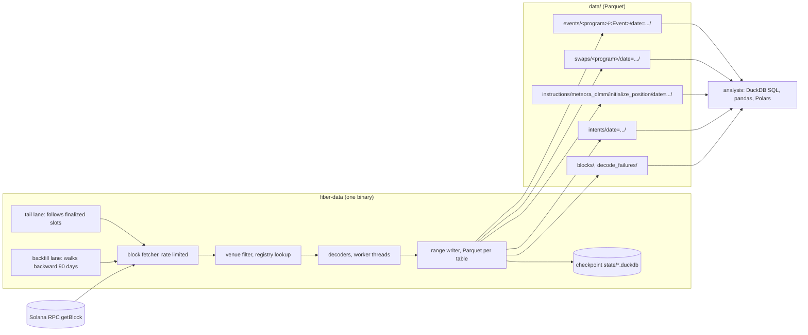
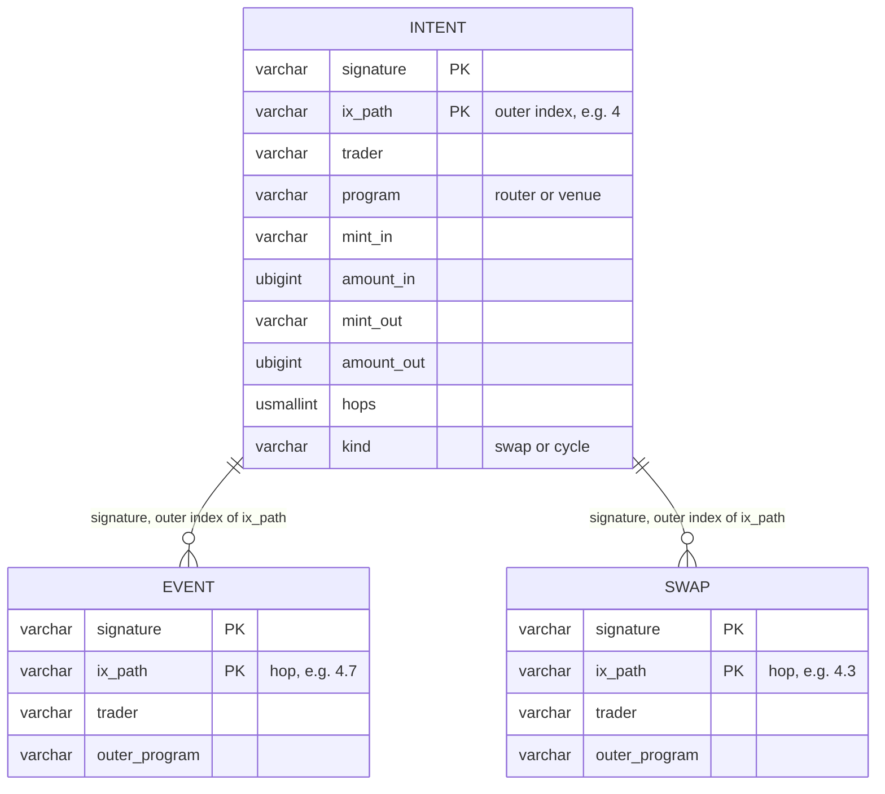
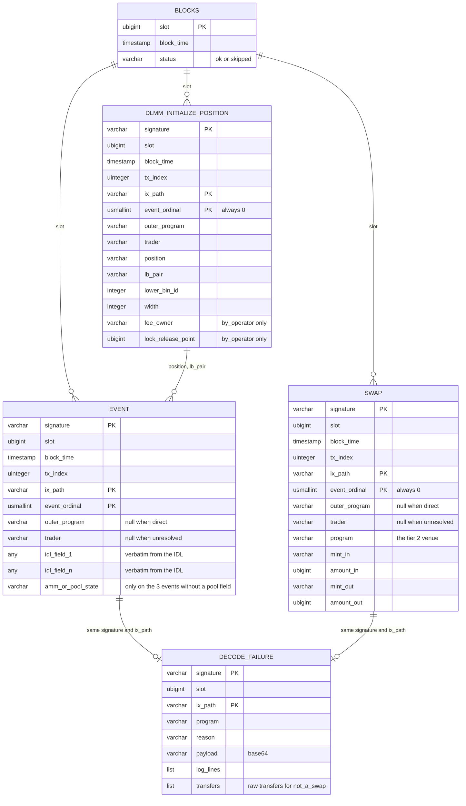

# fiber-data

A collector for Solana DEX activity. It reads every finalized block over RPC, keeps the
transactions that touch a DEX venue, and writes what the programs emitted as typed
Parquet tables: one table per program and event type for the ten open-source venues
(tier 1), one swap row per venue call for the proprietary AMMs and other venues that
emit no events (tier 2), one intent row per top-level instruction for wallet analytics,
plus coverage and failure tables. Nothing is normalised across venues; that is a later
layer. Design: `docs/superpowers/specs/2026-10-15-fiber-data-collector-design.md`.
Mechanics: `docs/architecture.md`. IDL provenance: `idl/SOURCES.md`.

## Setup

```sh
cp .env.example .env      # put your SOLANA_RPC_URL in .env (never committed)
npm install
npm test                  # 64 tests against real mainnet transactions in tests/fixtures/
npm run check             # type check
```

Node 24 runs the TypeScript directly; there is no build step.

## Running

```sh
npm run fiber-data -- registry check              # every registry program must be executable on-chain
npm run fiber-data -- tail --max-ranges 1          # one range of the live lane, then exit
npm run fiber-data -- tail                         # follow finalized slots forever
npm run fiber-data -- backfill --until 2026-07-17  # walk backward from the tail's start slot
npm run fiber-data -- status
npm run fiber-data -- verify --lane tail
npm run fiber-data -- query --sql "SELECT count(*) FROM events__meteora_dlmm__Swap2Evt"
docker compose up -d                                # tail + backfill as services
```

Rates, range size, paths and worker count live in `config/collector.json`. Venues are in
`config/venues.json` (generated by `node scripts/build-venues.ts`), routers in
`config/routers.json`.

## Pipeline



## Tables

| Table | One row per | Columns |
| --- | --- | --- |
| `events/<program>/<Event>` | emitted event of a tier 1 program | envelope + the IDL event's fields, verbatim; `amm` or `pool_state` added only where the event does not name its pool |
| `swaps/<program>` | tier 2 venue call that is a swap | envelope + `program, mint_in, amount_in, mint_out, amount_out` from the user side of the netted transfers |
| `intents` | top-level instruction containing venue calls | envelope + `program, mint_in, amount_in, mint_out, amount_out, hops, kind` (`swap` or `cycle`) |
| `instructions/meteora_dlmm/initialize_position` | DLMM position creation | envelope + `position, lb_pair, lower_bin_id, width, fee_owner, lock_release_point` |
| `blocks` | processed slot | `slot, block_time, status` (`ok` or `skipped`) |
| `decode_failures` | instruction that could not be decoded | `signature, slot, block_time, tx_index, ix_path, program, reason, payload, log_lines, transfers` |

Envelope, identical on every row: `signature, slot, block_time, tx_index, ix_path,
event_ordinal, outer_program, trader`. Amounts are base-unit integers (`UBIGINT`);
128-bit fields are exact decimal strings. Files are
`data/<table>/date=YYYY-MM-DD/<lo>-<hi>.parquet`, ZSTD, with `decoder_version`,
`idl_sha256`, `lane`, `lo_slot`, `hi_slot` in the Parquet metadata.



Hop rows and intent rows join on `signature` and the outer index of `ix_path`:



## Sizing

Measured on October 15, 2026 with one real 500-slot range from this collector: 32 KB per
slot, about 6.9 GB per day and 620 GB for a 90-day backfill, 684 MB peak memory. Details
in `docs/architecture.md`.
