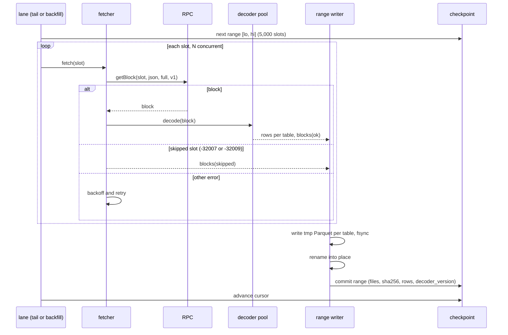
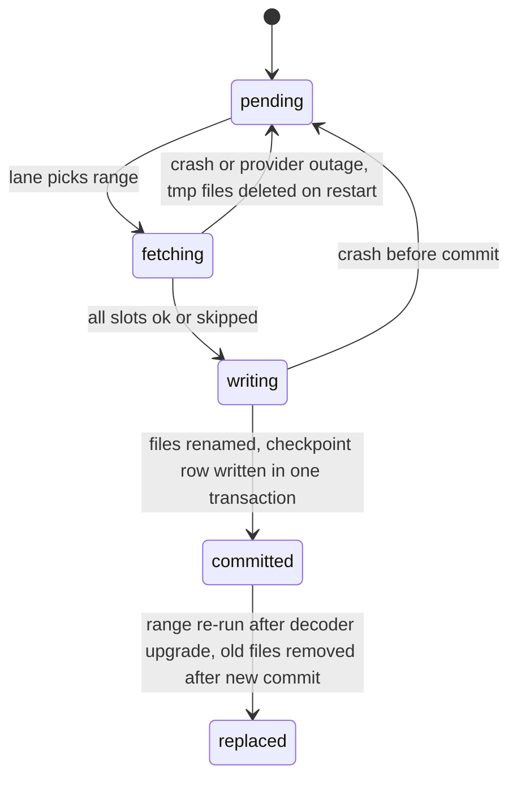
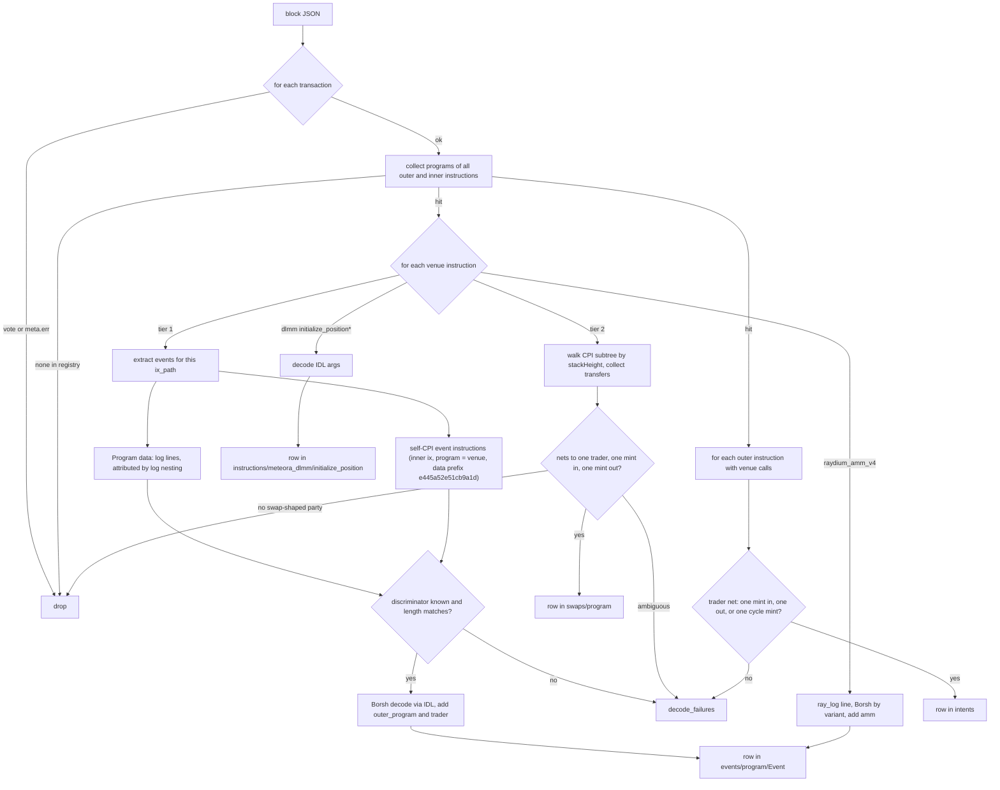

# How fiber-data works

Read the spec first: `docs/superpowers/specs/2026-10-15-fiber-data-collector-design.md`.
This page is the operational view: lanes, ranges, decoding, the trader rule, failures.

## Lanes and ranges

`tail` records the finalized slot it started at and follows new finalized slots forward,
staying `tipMargin` slots behind the tip. `backfill` starts one slot below the tail's
start slot and walks backward in ranges until `--until`. Each lane has its own checkpoint
database (`state/<lane>.duckdb`) and its own RPC rate from `config/collector.json`.

A range is written to `*.parquet.tmp` files, each fsynced and renamed into place, and only
then recorded in the checkpoint in one transaction. A crash before the commit leaves
temporary files that `tail` and `backfill` delete on start; the range is redone. A slot is
`skipped` only on the RPC's skipped-slot codes (-32007, -32009); every other error is
retried, so a range cannot commit with a hole.

## Decoding a block

- Instruction paths: outer index `i` (0-based); inner instructions `i.j`, `i.j.k` from
  `stackHeight`, siblings numbered from 1.
- Events are taken from self-CPI instructions first, then from `Program data:` log lines;
  a log event equal in path, discriminator and payload to one already taken is dropped.
- `outer_program` is the top-level program when it differs from the venue.

### Trader rule

Applied to every venue instruction, tier 1 and tier 2 alike, using the SPL Token,
Token-2022 and System transfers inside the instruction's CPI subtree. Each token
account's owner and mint come from, in order: the block's token balance metadata; the
`InitializeAccount*` or associated-token-account creation instruction in the same
transaction (wrapped-SOL accounts created and closed inside a transaction never appear in
balance metadata); the transfer's own authority account. A venue instruction with no
transfers in its subtree (proprietary AMMs post on-chain price updates many times per
block this way) is neither a swap nor an intent and produces no row and no failure.

1. Net the transfers by token-account owner. The two parties of a swap are the owners
   that sent exactly one mint and received exactly one other mint.
2. The **user side** is the party that signed the transaction. If neither party signed
   (routers such as Jupiter's shared-accounts mode hold tokens in program-owned
   accounts during the hops), the user side is the party whose token accounts are also
   used by transfers outside this instruction; the pool's vaults are only ever touched
   inside it.
3. `trader` is the user-side owner when it signed. Otherwise it is the single signer
   whose transaction-level token balances changed. If there is no such signer, or more
   than one, `trader` is null.

Instructions with no transfers in their subtree (position creation, claims that go to a
third party, administrative events) get `trader` null; their IDL fields carry `owner`
where the program defines one.

Verified on October 16, 2026 against 82 Jupiter-routed hops in live blocks: 79 resolved
at step 2 by signature, 3 by the outside-use rule with the trader found at step 3, none
unresolved. The fee payer was the trader in most but not all of them.

## 7. Error handling

| Failure | Handling |
| --- | --- |
| RPC 429, timeout, 5xx | retry with exponential backoff, rate halves temporarily; range stays open |
| Skipped slot (-32007, -32009) | `blocks.status = skipped`; counts as accounted |
| Block not yet available (-32004) on tail | wait and retry; tail stays a small margin below the finalized tip |
| Borsh decode error, unknown discriminator, length mismatch | `decode_failures` row; range continues |
| Venue instruction or outer instruction with no transfers, or no swap-shaped party | skipped; counted in `status` |
| Tier 2 call with a swap-shaped party but no resolvable user side | `decode_failures` reason `not_a_swap`, transfers attached |
| Outer instruction with a swap-shaped party but unresolvable trader or net over more than two mints | `decode_failures` reason `not_an_intent`, transfers attached |
| Log truncated | `decode_failures` reason `log_truncated` for affected tier 1 instructions |
| Crash mid-range | tmp files deleted on restart; range redone from checkpoint |
| Disk full | writer fails before rename; nothing committed; process exits non-zero |
| Registry program not executable on-chain | `registry check` fails at startup |

## Commands

| Command | Does |
| --- | --- |
| `fiber-data tail [--max-ranges N]` | run the tail lane |
| `fiber-data backfill --until <YYYY-MM-DD or slot> [--max-ranges N]` | run the backfill lane |
| `fiber-data status` | cursors, ranges committed, rows per table |
| `fiber-data verify [--lane tail or backfill]` | range contiguity, file checksums, slot coverage |
| `fiber-data redecode [--from S --to S]` | re-run decoders on `decode_failures` rows with the current IDLs |
| `fiber-data query --sql '...'` | DuckDB over the Parquet roots; one view per table, e.g. `events__meteora_dlmm__Swap2Evt` |
| `fiber-data registry check` | confirm every registry program is executable on-chain |

## Smoke test on the development machine

Recorded after Task 12 of the implementation plan; see the section at the end of this file.

### Smoke test record, October 15, 2026 (this machine)

Two runs against a Helius mainnet endpoint, decoder version 1.0.1.

Run 1, `rangeSlots` 50, `tail --max-ranges 2`: `registry check` found all 109 tier 1 and
tier 2 programs executable on-chain; two ranges committed; `verify` 0 problems.

Run 2, one realistic range: `rangeSlots` 500, `tipMargin` 1000 (so the range was available
at once), 10 blocks/s, concurrency 8, inline decoding:

| Measure | Result |
| --- | --- |
| range | 457353391–457353890, 554,516 transactions, 60,950 touching a venue |
| wall time | 4 min 14 s (RPC-bound; decode is about 40 ms per block) |
| peak memory | 684 MB resident, rows streamed to staging as blocks complete |
| files | 117 Parquet files, `verify` 0 problems |
| rows | 34,598 intents (33,489 `swap`, 1,109 `cycle`, trader resolved on 99.9%), 10,988 + 10,769 PumpSwap sell/buy events, 7,972 pump.fun trades, 5,651 DAMM v2 swaps |
| failures | 2,843 `not_an_intent` (flash-loan wrappers touching four mints, PDA-signed bot flows where no party signs, multi-output routes: the rule as written), 2,637 Raydium CLMM `SwapEvent` length mismatches (deployed layout is 16 bytes longer than the vendored IDL, spec §10), 87 `log_truncated`, 32 `not_a_swap` |
| size | 16.0 MB for 500 slots = 32 KB per slot, about 6.9 GB per day and 620 GB per 90 days |
