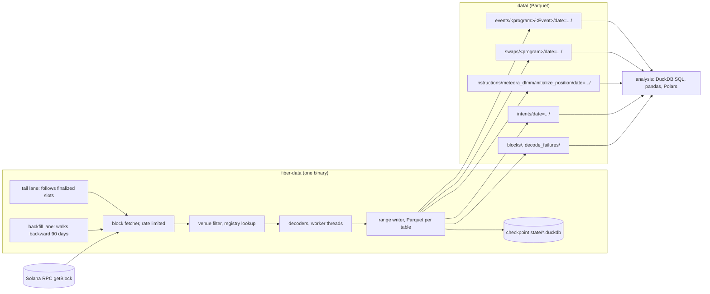
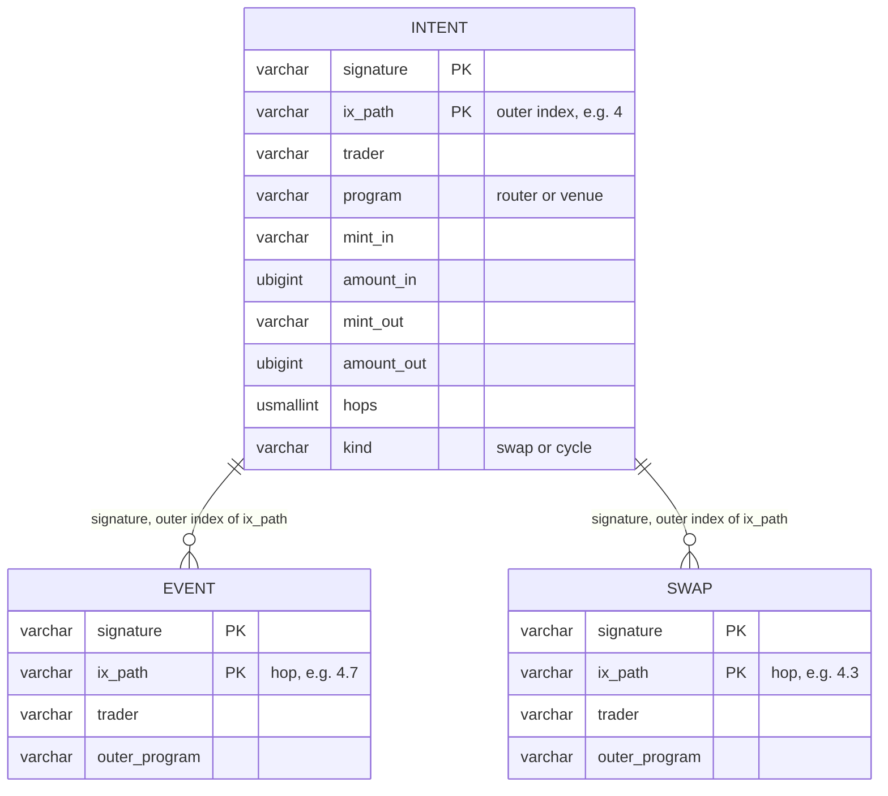
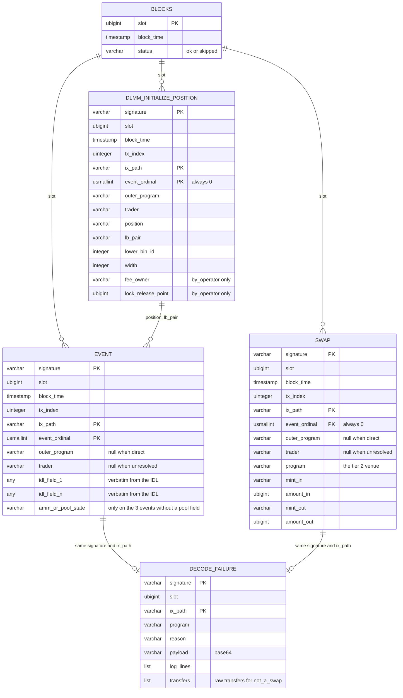
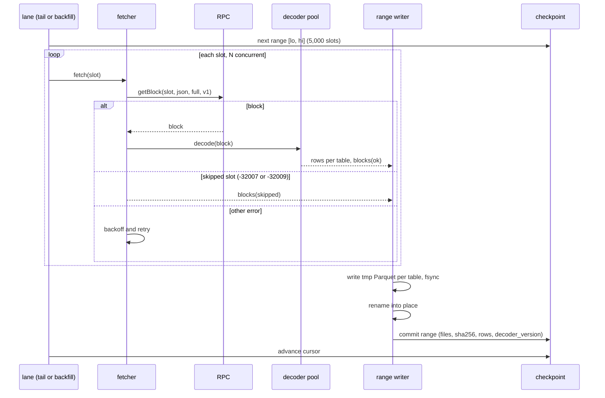
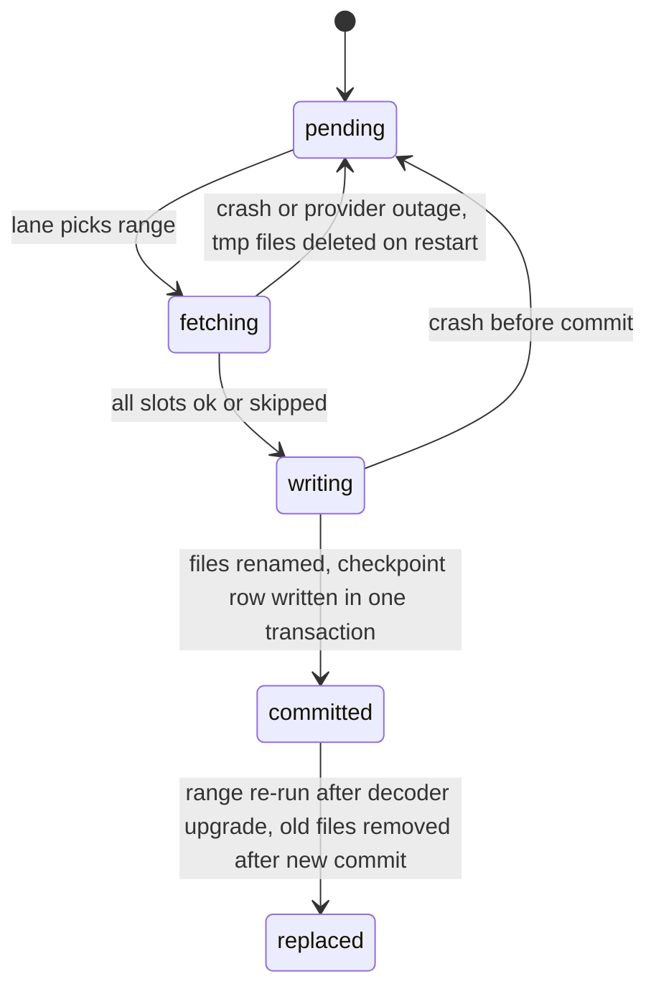
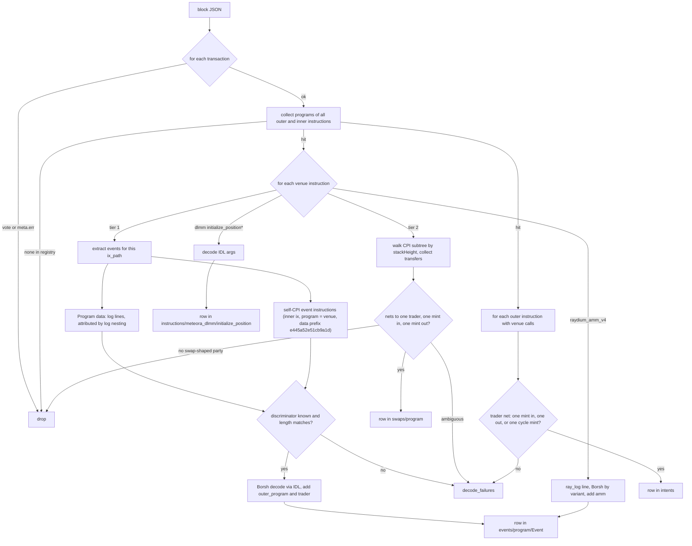

# fiber-data: Solana DEX raw event collector — design

Date: October 16, 2026 (revised). Status: draft for review.

## 1. Purpose

fiber-data collects on-chain swap and liquidity activity from Solana DEX programs and
stores it as queryable tables for quantitative analysis: backtesting, liquidity and
volume dynamics, LP strategy evaluation.

It stores what programs emitted, field for field from their IDLs. The one exception is
proprietary AMMs, which emit nothing; for them it stores one swap row per venue call,
derived from the token transfers inside the call by a rule stated in §4.

The analyses this dataset must support, chosen by the user:

1. Volume and flow per venue, pool, pair and wallet.
2. LP position lifecycle and fee earnings.
3. Router and frontend attribution of swaps.

### Decisions already made

| Topic | Decision |
| --- | --- |
| Venue scope | Near-all Solana spot swap venues, not Jupiter-only |
| History | Live tail plus about 90 days of backfill |
| Source | RPC `getBlock` over every finalized slot, filtered by a venue registry |
| Raw transactions | Not stored (measured at 3–6 TB per 90 days) |
| Storage | Parquet files partitioned by UTC day, queried with DuckDB |
| Tier 1 data model | One table per (program, event type), columns copied from the IDL |
| Tier 2 data model | One swap row per venue call, netted from token transfers |
| Intent level | One `intents` row per top-level instruction containing venue calls, for wallet analytics |
| Failed transactions | Dropped; nothing executed |
| Language | TypeScript on Node 24, IDL-driven decoding |

## 2. Architecture



### Components

| Component | Responsibility | Depends on |
| --- | --- | --- |
| `tail` lane | From the finalized slot at first start, follow new finalized slots forward in ranges | fetcher, writer, its own checkpoint |
| `backfill` lane | From the slot `tail` started at, walk backward in ranges until the target slot (about 90 days) | fetcher, writer, its own checkpoint |
| block fetcher | `getBlock` with `encoding: "json"`, `transactionDetails: "full"`, `maxSupportedTransactionVersion: 1`, `rewards: false`; token-bucket rate limit; retry with backoff | RPC URL from environment |
| venue filter | Drop vote and failed transactions. Keep a transaction if any outer or inner instruction's program is in the registry | `config/venues.json` |
| decoders | Tier 1: Anchor event decoding from the vendored IDLs; Raydium AMM v4 `ray_log` decoder. Tier 2: swap netting from token transfers | IDL files in `idl/` |
| range writer | Buffer rows per table for one slot range, write Parquet, sync, rename, commit checkpoint | DuckDB (`@duckdb/node-api`) |
| `verify` | Check slot coverage and file checksums over a range | checkpoint, data |
| `redecode` | Re-run decoders on `decode_failures` rows without RPC | decoders, data |

The JSON encoding makes the RPC node parse legacy, v0 and v1 messages, so the collector
has no wire-format parser. A transaction's full account list is `message.accountKeys`
followed by `meta.loadedAddresses.writable` then `.readonly`.

## 3. Venue registry

`config/venues.json` is the single list of programs the collector cares about, seeded
from Jupiter's `program-id-to-label` endpoint (107 programs on October 15, 2026) plus
Vybe's DEX list for programs Jupiter omits. Each entry:

```json
{ "program_id": "LBUZKhRxPF3XUpBCjp4YzTKgLccjZhTSDM9YuVaPwxo",
  "label": "meteora_dlmm", "kind": "dlmm", "tier": 1, "idl": "idl/meteora_dlmm.json" }
```

Inclusion rule: the program executes an atomic spot exchange of two tokens in one
instruction. Programs present in the source lists but excluded (LST stake routers such as
Sanctum and Solayer, lending, perps, Helium) stay in the file with `"kind": "excluded"`
and a reason, so exclusions are visible.

### Tier 1: event decoders (10 programs)

| Label | Program | IDL source | Events | Swap event | Liquidity, position and claim events |
| --- | --- | --- | --- | --- | --- |
| meteora_dlmm | `LBUZKhRxPF3XUpBCjp4YzTKgLccjZhTSDM9YuVaPwxo` | dlmm-sdk `idls/dlmm.json` v0.12.0 | 30 | Swap, Swap2Evt | AddLiquidity, RemoveLiquidity, Rebalancing, PositionCreate, PositionClose, ClaimFee, ClaimFee2, ClaimReward, ClaimReward2 |
| meteora_damm_v2 | `cpamdpZCGKUy5JxQXB4dcpGPiikHawvSWAd6mEn1sGG` | `idls/damm_v2.json` v0.1.5 | 27 | EvtSwap, EvtSwap2 | EvtAddLiquidity, EvtRemoveLiquidity, EvtLiquidityChange, EvtCreatePosition, EvtClosePosition, EvtClaimPositionFee, EvtClaimReward |
| meteora_dbc | `dbcij3LWUppWqq96dh6gJWwBifmcGfLSB5D4DuSMaqN` | `@meteora-ag/dynamic-bonding-curve-sdk` 2.0.0 bundled IDL, program v0.2.2 | 29 | EvtSwap, EvtSwap2, EvtSwap3 (+ transfer-hook variants) | none (bonding curve) |
| orca_whirlpool | `whirLbMiicVdio4qvUfM5KAg6Ct8VwpYzGff3uctyCc` | `@orca-so/whirlpools-sdk` 0.22.0 `whirlpool.json` | 6 | Traded | LiquidityIncreased, LiquidityDecreased, LiquidityRepositioned, PositionOpened |
| raydium_clmm | `CAMMCzo5YL8w4VFF8KVHrK22GGUsp5VTaW7grrKgrWqK` | raydium-idl `raydium_clmm.json` | 15 | SwapEvent | IncreaseLiquidityEvent, DecreaseLiquidityEvent, CreatePersonalPositionEvent, CollectPersonalFeeEvent, LiquidityChangeEvent |
| raydium_cpmm | `CPMMoo8L3F4NbTegBCKVNunggL7H1ZpdTHKxQB5qKP1C` | raydium-idl `raydium_cp_swap.json` v0.2.0 | 2 | SwapEvent | LpChangeEvent |
| raydium_amm_v4 | `675kPX9MHTjS2zt1qfr1NYHuzeLXfQM9H24wFSUt1Mp8` | no Anchor IDL; `ray_log` Borsh layout from raydium-amm source | 5 log variants | SwapBaseIn, SwapBaseOut | Deposit, Withdraw, Init |
| raydium_launchlab | `LanMV9sAd7wArD4vJFi2qDdfnVhFxYSUg6eADduJ3uj` | raydium-idl `raydium_launchpad.json` v0.2.0 | 4 | TradeEvent | none (bonding curve) |
| pumpswap | `pAMMBay6oceH9fJKBRHGP5D4bD4sWpmSwMn52FMfXEA` | pump-public-docs `pump_amm.json` | 27 | BuyEvent, SellEvent | DepositEvent, WithdrawEvent, CreatePoolEvent |
| pumpfun | `6EF8rrecthR5Dkzon8Nwu78hRvfCKubJ14M5uBEwF6P` | pump-public-docs `pump.json` | 32 | TradeEvent | none (bonding curve) |

Every event the IDL defines gets a table, administrative ones included; they are rare
and filtering is not the collector's job.

### Tier 2: swap rows only

All other registry venues. Notably the proprietary AMMs, which carry roughly a third of
Solana spot volume and emit no decodable events:

| Label | Program |
| --- | --- |
| bisonfi | `BiSoNHVpsVZW2F7rx2eQ59yQwKxzU5NvBcmKshCSUypi` |
| tessera_v | `TessVdML9pBGgG9yGks7o4HewRaXVAMuoVj4x83GLQH` |
| humidifi | `9H6tua7jkLhdm3w8BvgpTn5LZNU7g4ZynDmCiNN3q6Rp` |
| goonfi, goonfi_v2 | `goonERTdGsjnkZqWuVjs73BZ3Pb9qoCUdBUL17BnS5j`, `goonuddtQRrWqqn5nFyczVKaie28f3kDkHWkHtURSLE` |
| solfi, solfi_v2 | `SoLFiHG9TfgtdUXUjWAxi3LtvYuFyDLVhBWxdMZxyCe`, `SV2EYYJyRz2YhfXwXnhNAevDEui5Q6yrfyo13WtupPF` |
| zerofi | `ZERor4xhbUycZ6gb9ntrhqscUcZmAbQDjEAtCf4hbZY` |
| obric_v2 | `obriQD1zbpyLz95G5n7nJe6a4DPjpFwa5XYPoNm113y` |
| quantum | `QuaNtZsgYRe5Z9Bk4LZ4cTD9tbkVoyCNf1R2BN9bBDv` |
| alphaq | `ALPHAQmeA7bjrVuccPsYPiCvsi428SNwte66Srvs4pHA` |
| scorch | `ojh19ojaKduoJZuaJADhcVGp4xt1TcdAvZmpVsCorch` |
| manifest, phoenix, openbook_v2 (CLOBs; fills only) | `MNFSTqtC93rEfYHB6hF82sKdZpUDFWkViLByLd1k1Ms`, `PhoeNiXZ8ByJGLkxNfZRnkUfjvmuYqLR89jjFHGqdXY`, `opnb2LAfJYbRMAHHvqjCwQxanZn7ReEHp1k81EohpZb` |
| long tail | Lifinity v1/v2, Meteora DAMM v1, Saber, Stabble, Invariant, Byreal, Aquifer, PancakeSwap, Saros, Crema, Bonkswap, GooseFX, FluxBeam, Woofi, and the rest of the Jupiter list |

### Routers

`config/routers.json`: Jupiter v6 `JUP6LkbZbjS1jKKwapdHNy74zcZ3tLUZoi5QNyVTaV4`, Jupiter RFQ
`61DFfeTKM7trxYcPQCM78bJ794ddZprZpAwAnLiwTpYH` and `fd3nMFYTQjX1yr5ER8u7tPdHJB7qt8RpDpNtLQX2Br5`,
Raydium Routing `routeUGWgWzqBWFcrCfv8tritsqukccJPu3q5GPP3xS`, Titan
`T1TANpTeScyeqVzzgNViGDNrkQ6qHz9KrSBS4aNXvGT`, plus OKX DEX Router and DFlow once verified
on-chain. Routers never produce rows of their own; they appear as `outer_program` on the
venue rows they wrap. The registry is used for labelling only, not for capture: any
program at the top of a venue call is recorded, known router or not.

## 4. Data model

### Principles

1. A tier 1 table's columns are the IDL event's fields, with the IDL's names and types.
   Nothing is renamed, merged, dropped or computed.
2. A fixed eight-column envelope says where the row came from and who traded. It is
   identical on every table.
3. A column exists only if one of the three analyses in §1 needs it.
4. Amounts are integers in base units. No floats anywhere.

### Envelope (every table)

| Column | Type | Needed for |
| --- | --- | --- |
| `signature` | VARCHAR | identity, lookup |
| `slot` | UBIGINT | ordering, partition and range key |
| `block_time` | TIMESTAMP (UTC, seconds) | time axis. Derivable from `blocks` by slot, kept on the row so billion-row scans need no join |
| `tx_index` | UINTEGER | order within a block, so two swaps on one pool in the same slot can be sequenced |
| `ix_path` | VARCHAR, e.g. `4.7` | which instruction produced the row; one transaction with four hops gives four rows |
| `event_ordinal` | USMALLINT | order among events of the same type from one instruction |
| `outer_program` | VARCHAR, null | the program of the top-level instruction when it differs from the venue: router or frontend attribution (analysis 3). Null for direct calls |
| `trader` | VARCHAR, null | the wallet that traded through this instruction, by the rule below: wallet analytics (analysis 1). Not the fee payer, which is often a relayer or bot infrastructure |

Row identity is `(signature, ix_path, event_ordinal)`.

### Trader rule

Applied to every venue instruction, tier 1 and tier 2 alike, using the SPL Token,
Token-2022 and System transfers inside the instruction's CPI subtree. Each token
account's owner and mint come from, in order: the block's token balance metadata; the
`InitializeAccount*` or associated-token-account creation instruction in the same
transaction (wrapped-SOL accounts created and closed inside a transaction never appear in
balance metadata); the transfer's own authority account. A venue instruction with no
transfers in its subtree (proprietary AMMs post on-chain price updates many times per
block this way) is neither a swap nor an intent and produces no row and no failure.

1. Net the transfers by token-account owner. The two parties of a swap are the owners
   that sent exactly one mint and received exactly one other mint.
2. The **user side** is the party that signed the transaction. If neither party signed
   (routers such as Jupiter's shared-accounts mode hold tokens in program-owned
   accounts during the hops), the user side is the party whose token accounts are also
   used by transfers outside this instruction; the pool's vaults are only ever touched
   inside it.
3. `trader` is the user-side owner when it signed. Otherwise it is the single signer
   whose transaction-level token balances changed. If there is no such signer, or more
   than one, `trader` is null.

Instructions with no transfers in their subtree (position creation, claims that go to a
third party, administrative events) get `trader` null; their IDL fields carry `owner`
where the program defines one.

Verified on October 16, 2026 against 82 Jupiter-routed hops in live blocks: 79 resolved
at step 2 by signature, 3 by the outside-use rule with the trader found at step 3, none
unresolved. The fee payer was the trader in most but not all of them.

### Tier 1: `events/<program>/<Event>`

Envelope plus the IDL fields. Three event types do not name their pool, and for exactly
those the decoder adds one column taken from the IDL-named account of the emitting
instruction:

| Table | Added column | Source |
| --- | --- | --- |
| `raydium_amm_v4/*` (all five ray_log variants) | `amm` | the instruction's `amm` account |
| `raydium_clmm/IncreaseLiquidityEvent` | `pool_state` | `increase_liquidity*` account index 2 |
| `raydium_clmm/DecreaseLiquidityEvent` | `pool_state` | `decrease_liquidity*` account index 3 |

Type mapping (Borsh to Parquet, mechanical):

| IDL type | Column type |
| --- | --- |
| `u8`, `u16`, `u32` | UINTEGER |
| `u64` | UBIGINT |
| `i8`, `i16`, `i32` | INTEGER |
| `i64` | BIGINT |
| `u128`, `i128` | VARCHAR holding the decimal string. DuckDB writes 128-bit integers to Parquet as DOUBLE, which loses exactness; a decimal string is exact and casts on read with `::UHUGEINT` |
| `bool` | BOOLEAN |
| `bytes` | VARCHAR, hex |
| `string` | VARCHAR |
| `pubkey` | VARCHAR (base58) |
| `[T; N]`, `vec<T>` | LIST |
| `defined` struct | STRUCT with the struct's field names, nested |
| enum | VARCHAR, variant name |
| `option<T>` | nullable |

Example, a real row from slot 457304333 in `events/meteora_dlmm/Swap2Evt`:

```text
signature        4ZhGP3TBXtCQcKc9bVrhdLEbGzw3zbtTZFaejt7zenda912KDyWt33EgNmdF42HNYQwLwndRV8ga6Bg5osipEprz
slot             457304333
block_time       2026-10-15 16:28:49
tx_index         683
ix_path          4.7
event_ordinal    0
outer_program    JUP6LkbZbjS1jKKwapdHNy74zcZ3tLUZoi5QNyVTaV4
trader           NALUxTJsozrScVNzRWy9LAg2xoC37RXNNZyyem76kmc
--- IDL fields ---
lb_pair          G7ixPyiyNeggVf1VanSetFMNbVuVCPtimJmd9axfQqng
from             NALUxTJsozrScVNzRWy9LAg2xoC37RXNNZyyem76kmc
start_bin_id     37681
end_bin_id       37681
swap_for_y       true
fee_bps          134311
amount_in        13311167
amount_left      0
amount_out       576157224
mm_fee           1610
protocol_fee     178
limit_order_fee  0
host_fee         0
fees_on_input    true
fees_on_token_x  true
```

### Tier 2: `swaps/<program>`

One row per tier 2 venue call that is a swap. Envelope (with `event_ordinal` always 0)
plus:

| Column | Type | Needed for |
| --- | --- | --- |
| `program` | VARCHAR | the venue (analysis 1) |
| `mint_in`, `amount_in` | VARCHAR, UBIGINT | what the user side gave (analysis 1) |
| `mint_out`, `amount_out` | VARCHAR, UBIGINT | what the user side received (analysis 1) |

**Netting rule.** Steps 1 and 2 of the trader rule identify the parties and the user
side; `amount_in` and `mint_in` are what the user side sent, `amount_out` and `mint_out`
what it received. Native SOL legs are System `Transfer`s and use mint `So11…1112`. The
pool side may be one owner or several (some venues keep one vault authority per mint);
only the user side must net to one mint each way. A call whose transfers contain no
swap-shaped party (order placement on a CLOB, a fee payment) is not a swap and is
skipped silently. A call with a swap-shaped party but no resolvable user side goes to
`decode_failures` with reason `not_a_swap` and the raw transfers attached. This
derivation exists because proprietary AMMs emit nothing else.

Example, a real row from slot 457304346 in `swaps/humidifi`, routed by Titan:

```text
signature        aZ3u52RVsFPxBCaf7JHJxsZixXmioRWQjepDcBDSVSBcFM98wcLdtXTGdiVQXKaBZ1ntj8vbL6hoovfcf4cpH6x
slot             457304346
block_time       2026-10-15 16:28:54
tx_index         <from block>
ix_path          0.13
event_ordinal    0
outer_program    T1TANpTeScyeqVzzgNViGDNrkQ6qHz9KrSBS4aNXvGT
trader           2qCe3m9K22cGH9UXhaHDafqk47zJLnwA1d13m8j5PBbB
program          9H6tua7jkLhdm3w8BvgpTn5LZNU7g4ZynDmCiNN3q6Rp
mint_in          EPjFWdd5AufqSSqeM2qN1xzybapC8G4wEGGkZwyTDt1v
amount_in        4238790
mint_out         pumpCmXqMfrsAkQ5r49WcJnRayYRqmXz6ae8H7H9Dfn
amount_out       942027658
```

The trader signed the transaction and sent USDC to a HumidiFi inventory account, receiving
PUMP from another. The inventory accounts' owner did not sign, so step 2 picks the right
side.

### Instruction table: `instructions/meteora_dlmm/initialize_position`

A DLMM position's bin range is passed as instruction arguments and appears in no event.
Analysis 2 cannot tell whether a position was in range without it. This is the only
instruction table. Rows come from `initialize_position`, `initialize_position2`,
`initialize_position_pda` and `initialize_position_by_operator`. Columns: envelope, the
IDL-named accounts `position` and `lb_pair`, and the IDL arguments `lower_bin_id` (INTEGER)
and `width` (INTEGER). The variant's extra arguments (`fee_owner`, `lock_release_point`)
are included for `initialize_position_by_operator` and null otherwise.

### Intent level: `intents`

Every row above is one hop: one venue instruction. A route USDC to SOL to BTC through
two venues is two rows. Wallet analytics needs the other level, what the trader set out
to do, and that cannot be rebuilt from hop rows later: tier 1 amounts sit in
venue-specific fields, routers take fees outside the hops (a measured shared-accounts
route sent 100 USDC while its hop received 99.8), and the transfer data is not kept. So
the collector writes one `intents` row per top-level instruction that contains at least
one venue call. Envelope, with `ix_path` the outer instruction index (e.g. `4`),
`event_ordinal` 0, `outer_program` null, `trader` by the trader rule applied to the whole
outer instruction's subtree, plus:

| Column | Type | Meaning |
| --- | --- | --- |
| `program` | VARCHAR | the top-level program: a router, or the venue itself for a direct call |
| `mint_in`, `amount_in` | VARCHAR, UBIGINT | the mint the trader sent and the gross amount sent inside this instruction |
| `mint_out`, `amount_out` | VARCHAR, UBIGINT | the mint the trader received and the gross amount received |
| `hops` | USMALLINT | number of venue rows (events and swaps) under this instruction |
| `kind` | VARCHAR | `swap` when the mints differ; `cycle` when they are the same mint (arbitrage; profit is `amount_out` minus `amount_in`) |

Identity is `(signature, ix_path)`. The trader's net is taken over the mints the hops
traded, after removing fee legs: transfers from the trader to an owner that only receives
in this instruction and is not a party to any hop (router platform fees, frontend fees).
An outer instruction with no swap-shaped party (only a wrapped-SOL wrap, only fee
transfers) is not an intent and is skipped silently. One with a swap-shaped party whose
net still touches more than two mints, or whose trader cannot be resolved, goes to
`decode_failures` with reason `not_an_intent`. Gross rather than net amounts are what let
a cycle use the same four columns. Fees paid to third parties are not stored.

An intent at `ix_path = "4"` owns every hop row of the same signature whose `ix_path`
starts with `4.`, or equals `4` for a direct one-hop call. The four-hop Jupiter route
above gives one intent row (program Jupiter, kind `cycle`, hops 4) and four hop rows at
`4.1`, `4.3`, `4.5`, `4.7`.



### Coverage and failures

| Table | Columns | Needed for |
| --- | --- | --- |
| `blocks` | `slot`, `block_time`, `status` (`ok` or `skipped`) | proof that no slot was missed; `verify` reads it |
| `decode_failures` | `signature`, `slot`, `block_time`, `tx_index`, `ix_path`, `program`, `reason`, `payload` (VARCHAR, base64: for events the 8-byte discriminator followed by the event bytes; for `log_truncated` the instruction data), `log_lines` (VARCHAR[], the failing instruction's own log lines), `transfers` (LIST of STRUCT source, destination, owner_source, owner_destination, mint, amount) | the only place event bytes, log lines and raw transfers are kept; input to `redecode` |

### Entity diagram



`EVENT` stands for every tier 1 table, e.g. `events/meteora_dlmm/Swap2Evt` or
`events/orca_whirlpool/Traded`; each has its own IDL columns.

### What the analyses read

| Analysis | Reads | Resolved later, outside the collector |
| --- | --- | --- |
| 1. Volume per venue, pool, pair, wallet | hop level: tier 1 swap events (pool, amounts), tier 2 `swaps` (mints, amounts). Wallet level: `intents` | pool to mints for tier 1 pools, by a one-time RPC lookup of each pool account seen; pool accounts persist on chain. Token decimals, by `getMint` for each mint seen |
| 2. LP lifecycle and fees | tier 1 liquidity, position and claim events; `initialize_position` for DLMM ranges; DLMM `end_bin_id` on swaps gives the active-bin path | none |
| 3. Router and frontend attribution | `outer_program` | labels for program IDs, from `config/routers.json`. Frontends that charge by a plain SOL transfer and use no program of their own are not identified |

### Not stored, deliberately

Raw transactions. Events of failed transactions. Instruction bytes and log lines of
successful instructions. Account lists. Token transfers of tier 1 venues (their events
carry the amounts). Pool state beyond what events carry. Token decimals, names and
symbols. USD values. Order-book placements on CLOBs.

### Layout on disk

```text
data/
  events/meteora_dlmm/Swap2Evt/date=2026-10-15/457300000-457305000.parquet
  events/pumpswap/BuyEvent/date=2026-10-15/...
  swaps/humidifi/date=2026-10-15/...
  instructions/meteora_dlmm/initialize_position/date=2026-10-15/...
  intents/date=2026-10-15/...
  blocks/date=2026-10-15/...
  decode_failures/date=2026-10-15/...
state/tail.duckdb
state/backfill.duckdb
```

Parquet files are ZSTD compressed, sorted by `(slot, tx_index, ix_path)`, with key-value
metadata `decoder_version`, `idl_sha256`, `lane`, `lo_slot`, `hi_slot`. Query example:
`SELECT * FROM read_parquet('data/events/meteora_dlmm/Swap2Evt/**/*.parquet')`.

## 5. Collection mechanics

### Lanes and ranges





- `tail` records its start slot once, then follows finalized slots forward. It opens a range
  only when a full `rangeSlots` of finalized slots is available (about 33 minutes of chain
  time at the default), so file sizes stay uniform; a partial range would mean one Parquet
  file per table every few slots.
- `backfill` starts at that start slot and walks backward to `target_slot` (configured
  as a date, resolved to a slot once and stored).
- A range is never partially visible: files are written as `*.<lane>.tmp`, synced, renamed,
  then recorded. Nothing is appended to an existing file. Staging and temporary files are
  scoped to their lane, so a restarting lane never deletes the other lane's in-flight files.
- Rows are streamed to per-table staging files as each block is decoded; a range is never
  held in memory (measured peak 0.7 GB for a 500-slot range).
- A slot is `skipped` only on the RPC's skipped-slot error codes. Any other failure
  retries; a range cannot commit with an unaccounted slot.

The checkpoint database holds one row per committed range: `lane`, `lo_slot`, `hi_slot`,
`status`, `decoder_version`, the file list with SHA-256 and row counts, `committed_at`.
It is operational state, not part of the dataset.

### Decoding a block



- Instruction paths: outer index `i`; inner instructions get `i.j`, `i.j.k`, … from
  `innerInstructions[].instructions[].stackHeight`, numbering siblings from 1.
- Log attribution: `Program X invoke [n]` and `Program X success` lines form a stack; a
  `Program data:` line belongs to the program on top and to the instruction executing
  at that depth.
- Some programs (PumpSwap, pump.fun, LaunchLab) emit the same event through both
  channels. Self-CPI events are taken first; a log event whose path, discriminator and
  payload bytes equal one already taken is dropped, so each emitted event is one row.
- Log truncation (`Log truncated`) loses later log-emitted events; every tier 1
  instruction of such a transaction that yielded no event from either channel gets a
  `decode_failures` row with reason `log_truncated`. Self-CPI events are unaffected.
- `outer_program` is the program of the outer instruction `i` when it is not the venue
  itself. `trader` follows the rule in §4 for every venue instruction.

### Rate limiting and provider

Token bucket per lane, in blocks per second (`config/collector.json`). 429 and timeouts
halve the rate temporarily and back off. The RPC URL is read from `.env`
(`SOLANA_RPC_URL`) and never logged. All reads use `finalized` commitment.

### Commands

| Command | Does |
| --- | --- |
| `fiber-data tail` | run the tail lane |
| `fiber-data backfill --until 2026-07-17` | run the backfill lane down to the first slot at or after that UTC date, found by binary search on block times |
| `fiber-data status` | cursors, ranges committed, rows per table, bytes per day |
| `fiber-data verify [--lane] [--from --to]` | slot coverage, file checksums, metadata |
| `fiber-data redecode --from --to` | re-run decoders on `decode_failures` rows |
| `fiber-data query --sql '...'` | DuckDB over the Parquet roots |
| `fiber-data registry check` | confirm every registry program exists on-chain and is executable |

## 6. Infrastructure and reproducibility

- Node 24, TypeScript, `@duckdb/node-api` for Parquet writing and queries, no ORM.
- Config in `config/` (venues, routers, collector rates and range size); secrets in
  `.env` (0600, git-ignored). IDLs vendored in `idl/` with source and version recorded in
  `idl/SOURCES.md`.
- `docker compose up -d` runs `tail` and `backfill` as two services sharing `data/` and
  `state/` volumes. Native run is `node dist/cli.js tail`.
- Moving to the larger machine: copy the repo, `data/` and `state/`, set the env file,
  start. Files are relative to the data root; no absolute paths are recorded.
- Decoder version is a constant in code, bumped whenever an IDL or decoder changes; it
  is written into every Parquet file's metadata and every checkpoint row.

## 7. Error handling

| Failure | Handling |
| --- | --- |
| RPC 429, timeout, 5xx | retry with exponential backoff; the limiter halves its rate and doubles back every 30 s of calm; range stays open |
| `getBlock` returns `null` (block not available on this node) | retried like -32004; never recorded as skipped |
| Skipped slot (-32007, -32009) | `blocks.status = skipped`; counts as accounted |
| Block not yet available (-32004) on tail | wait and retry; tail stays a small margin below the finalized tip |
| Borsh decode error, unknown discriminator, length mismatch | `decode_failures` row; range continues |
| Venue instruction or outer instruction with no transfers, or no swap-shaped party | skipped; counted in `status` |
| Tier 2 call with a swap-shaped party but no resolvable user side | `decode_failures` reason `not_a_swap`, transfers attached |
| Outer instruction with a swap-shaped party but unresolvable trader or net over more than two mints | `decode_failures` reason `not_an_intent`, transfers attached |
| Log truncated | `decode_failures` reason `log_truncated` for affected tier 1 instructions |
| Crash mid-range | tmp files deleted on restart; range redone from checkpoint |
| Disk full | writer fails before rename; nothing committed; process exits non-zero |
| Registry program not executable on-chain | `registry check` fails at startup |

## 8. Testing

- Fixture transactions as JSON in `tests/fixtures/`, fetched once, with expected rows
  asserted per decoder: every tier 1 event type at least once; tier 2 swaps through
  Jupiter and Titan; a Token-2022 `TransferChecked`; a native SOL leg; a self-CPI event
  and a log-emitted event; a log-truncated transaction; a version 1 transaction; a tier 2
  call that must land in `decode_failures` as `not_a_swap`; a Jupiter shared-accounts
  route where no hop party signs, asserting both its hop rows and its intent row
  including the router fee gap; an arbitrage cycle as an intent of kind `cycle`; a relayer-paid transaction where the fee payer is not
  the trader; the three events that need
  the added `amm` or `pool_state` column; each DLMM `initialize_position*` variant.
- Range writer: kill mid-range, assert no registered file and no duplicate rows after
  resume.
- `verify` over a synthetic range containing a skipped slot and a retried fetch.
- IDL drift: a fixture whose event length differs from the IDL must land in
  `decode_failures`, not in an event table.
- Before the 90-day backfill: run `tail` for a few thousand slots and read `status` for
  measured bytes per day.

## 9. Sizing

Measured October 16, 2026 by running 60 consecutive live mainnet blocks (slots
457304xxx, about 16:30 UTC) through every rule in this document and writing each table to
ZSTD-3 Parquet with pyarrow. 114 venue transactions per block.

| Table group | Rows per day | GB per day | GB per 90 days |
| --- | --- | --- | --- |
| events/pumpswap | 17.1M | 2.83 | 255 |
| intents | 13.0M | 1.53 | 138 |
| swaps (all tier 2) | 2.2M | 0.86 | 78 |
| events/meteora_dlmm | 3.1M | 0.68 | 61 |
| events/pumpfun | 4.0M | 0.67 | 61 |
| events/meteora_damm_v2 | 2.0M | 0.47 | 42 |
| decode_failures | 1.6M | 0.34 | 31 |
| events/orca_whirlpool | 0.9M | 0.19 | 18 |
| events/raydium_* (4 programs) | 0.5M | 0.27 | 24 |
| blocks | 0.2M | 0.00 | 0.4 |
| **Total** | **44.5M** | **7.9** | **707** |

Reading the number: the sample is 24 seconds of chain time at a busy hour, so treat it as
**6–10 GB per day, 0.5–1 TB for the 90-day backfill, and about 3 TB per year of live
tail**. The per-row cost of the small tables is inflated by per-file overhead in the
60-block sample (a production file covers 5,000 slots), so the true total is nearer the
low end. Not in the sample: Meteora DBC events (IDL not yet vendored, 0.6% of volume)
and Raydium CLMM `SwapEvent` rows that failed on an IDL mismatch (see §10). Rows per
day for the three analyses: about 27M hop-level swap events plus 2.2M tier 2 swaps, and
13M intents, of which 94% are `swap` and 6% `cycle`; the trader resolved on 99.8% of
intents.

Backfill of about 19M slots at 10 blocks per second is about 22 days; the bound is the
RPC plan, not the code.

## 10. Open items for the implementation plan

- Verify on-chain, with `registry check`, every program ID in §3.
- Confirm the DBC IDL version bundled in the SDK matches the deployed program's event
  discriminators.
- Confirm the `ray_log` layouts and the `amm` account index per instruction against the
  current raydium-amm source.
- Pin a Raydium CLMM IDL that matches the deployed program: with the IDL downloaded on
  October 15, 2026, 152 of 161 `SwapEvent` payloads in the sample failed on length
  mismatch, so the deployed event layout differs from that file. Same check for
  LaunchLab `PoolCreateEvent` (2 of 2 failed).
- Confirm the vendored DBC IDL (program v0.2.2, from the SDK bundle) against live `EvtSwap2`/`EvtSwap3` payloads in the first run.
- Measure actual bytes per day before launching the backfill.
