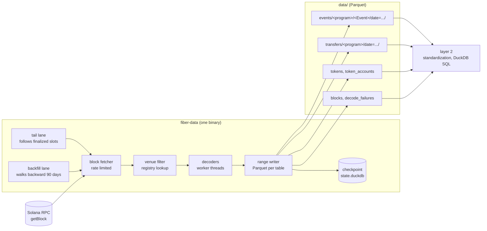
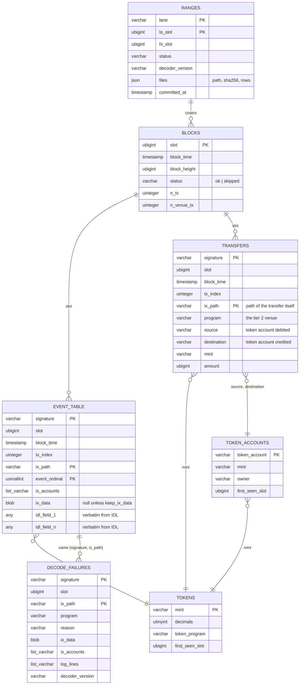
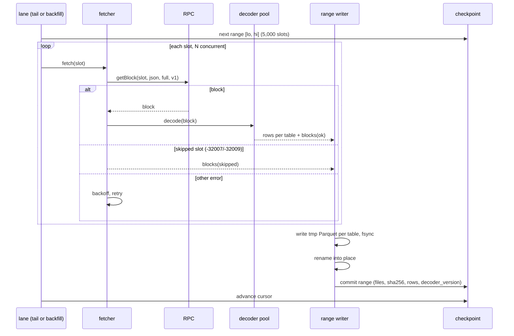
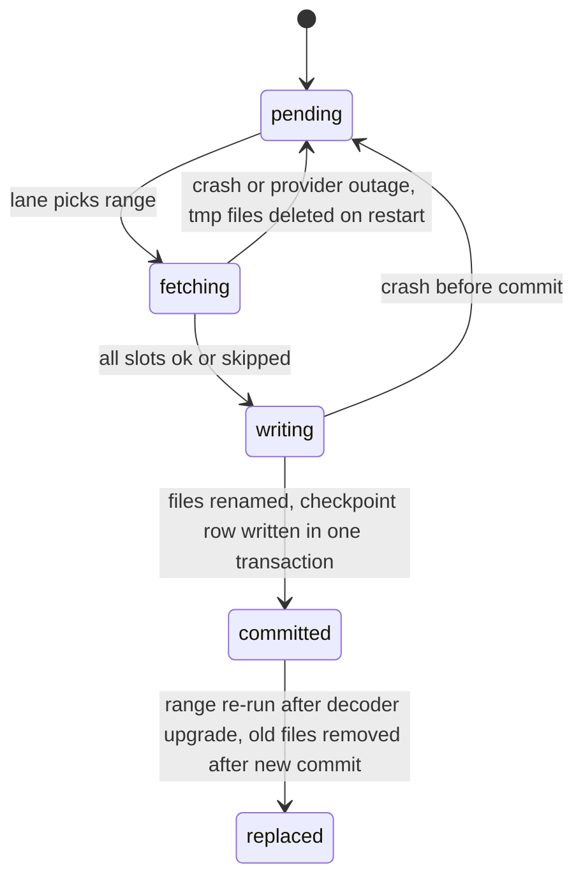
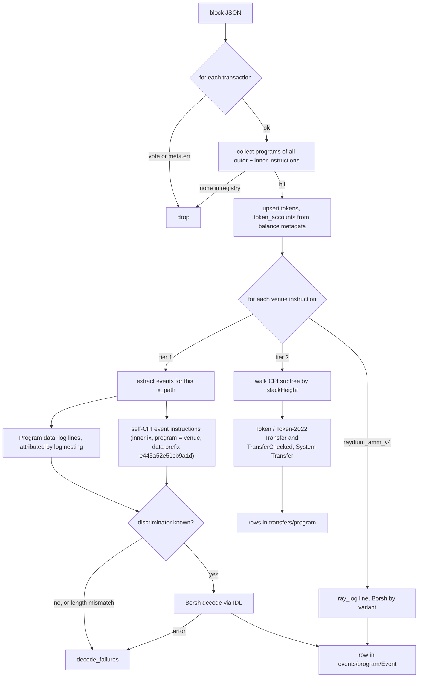

# fiber-data: Solana DEX raw event collector — design

Date: October 15, 2026. Status: draft for review.

## 1. Purpose

fiber-data collects on-chain swap and liquidity activity from Solana DEX programs
and stores it as queryable tables for quantitative analysis: backtesting, liquidity
and volume dynamics, and LP strategy evaluation.

This document describes **layer 1**: collection of raw event data. It stores what
programs emitted, field for field, and nothing derived. Standardization into
cross-venue swap and liquidity tables is **layer 2**, a separate project that reads
layer 1's output.

### Decisions already made

| Topic | Decision |
| --- | --- |
| Venue scope | Near-all Solana spot swap venues, not Jupiter-only |
| History | Live tail plus about 90 days of backfill |
| Source | RPC `getBlock` over every finalized slot, filtered by a venue registry |
| Raw transactions | Not stored (storage measured at 3–6 TB per 90 days) |
| Storage | Parquet files, partitioned by UTC day, queried with DuckDB |
| Data model | One table per (program, event type), columns copied from the IDL |
| Venues without events | Minimal token-transfer rows per venue call |
| Failed transactions | Dropped; nothing executed |
| Language | TypeScript on Node 24, IDL-driven decoding |

## 2. Architecture



### Components

| Component | Responsibility | Depends on |
| --- | --- | --- |
| `tail` lane | From the finalized slot at first start, follow new finalized slots forward in ranges | fetcher, writer, its own checkpoint |
| `backfill` lane | From the slot `tail` started at, walk backward in ranges until the target slot (about 90 days) | fetcher, writer, its own checkpoint |
| block fetcher | `getBlock` with `encoding: "json"`, `transactionDetails: "full"`, `maxSupportedTransactionVersion: 1`, `rewards: false`; token-bucket rate limit; retry with backoff | RPC URL from environment |
| venue filter | Drop vote transactions and failed transactions. Keep a transaction if any outer or inner instruction's program is in the registry | `config/venues.json` |
| decoders | Tier 1: Anchor event decoding from the checked-in IDLs. Raydium AMM v4: `ray_log` decoder. Tier 2: token-transfer extraction | IDL files in `idl/` |
| range writer | Buffer rows per table for one slot range, write Parquet, sync, rename, commit checkpoint | DuckDB (`@duckdb/node-api`) |
| `verify` | Check slot coverage and file checksums over a range | checkpoint, data |
| `redecode` | Re-run decoders on `decode_failures` rows without RPC | decoders, data |

The JSON encoding makes the RPC node parse legacy, v0 and v1 transaction messages, so
the collector carries no wire-format parser. The full account list of a transaction is
`message.accountKeys` followed by `meta.loadedAddresses.writable` then `.readonly`.

## 3. Venue registry

`config/venues.json` is the single list of programs the collector cares about. It is
seeded from Jupiter's `program-id-to-label` endpoint (107 programs on October 15,
2026) plus Vybe's DEX list for programs Jupiter omits. Each entry:

```json
{ "program_id": "LBUZKhRxPF3XUpBCjp4YzTKgLccjZhTSDM9YuVaPwxo",
  "label": "meteora_dlmm", "kind": "dlmm", "tier": 1,
  "idl": "idl/meteora_dlmm.json",
  "keep_ix_data": ["initialize_position", "initialize_position_pda", "initialize_position_by_operator"] }
```

Inclusion rule: the program executes an atomic spot exchange of two tokens in one
instruction. Programs present in the source lists but excluded (LST stake routers such
as Sanctum and Solayer, lending, perps, Helium) stay in the file with
`"kind": "excluded"` and a reason, so exclusions are visible.

### Tier 1: event decoders (10 programs)

| Label | Program | IDL source | Events | Swap event | Liquidity events |
| --- | --- | --- | --- | --- | --- |
| meteora_dlmm | `LBUZKhRxPF3XUpBCjp4YzTKgLccjZhTSDM9YuVaPwxo` | dlmm-sdk `idls/dlmm.json` v0.12.0 | 30 | Swap, Swap2Evt | AddLiquidity, RemoveLiquidity, Rebalancing, PositionCreate/Close, ClaimFee/ClaimFee2, ClaimReward/ClaimReward2 |
| meteora_damm_v2 | `cpamdpZCGKUy5JxQXB4dcpGPiikHawvSWAd6mEn1sGG` | `idls/damm_v2.json` v0.1.5 | 27 | EvtSwap, EvtSwap2 | EvtAddLiquidity, EvtRemoveLiquidity, EvtLiquidityChange, EvtCreate/ClosePosition, EvtClaimPositionFee, EvtClaimReward |
| meteora_dbc | `dbcij3LWUppWqq96dh6gJWwBifmcGfLSB5D4DuSMaqN` | `@meteora-ag/dynamic-bonding-curve-sdk` 2.0.0 bundled IDL | 21 | EvtSwap | none (bonding curve) |
| orca_whirlpool | `whirLbMiicVdio4qvUfM5KAg6Ct8VwpYzGff3uctyCc` | `@orca-so/whirlpools-sdk` 0.22.0 `whirlpool.json` | 6 | Traded | LiquidityIncreased, LiquidityDecreased, LiquidityRepositioned, PositionOpened |
| raydium_clmm | `CAMMCzo5YL8w4VFF8KVHrK22GGUsp5VTaW7grrKgrWqK` | raydium-idl `raydium_clmm.json` | 15 | SwapEvent | IncreaseLiquidityEvent, DecreaseLiquidityEvent, CreatePersonalPositionEvent, CollectPersonalFeeEvent, LiquidityChangeEvent |
| raydium_cpmm | `CPMMoo8L3F4NbTegBCKVNunggL7H1ZpdTHKxQB5qKP1C` | raydium-idl `raydium_cp_swap.json` v0.2.0 | 2 | SwapEvent | LpChangeEvent |
| raydium_amm_v4 | `675kPX9MHTjS2zt1qfr1NYHuzeLXfQM9H24wFSUt1Mp8` | no Anchor IDL; `ray_log` Borsh layout from raydium-amm source | 5 log variants | SwapBaseIn, SwapBaseOut | Deposit, Withdraw, Init |
| raydium_launchlab | `LanMV9sAd7wArD4vJFi2qDdfnVhFxYSUg6eADduJ3uj` | raydium-idl `raydium_launchpad.json` v0.2.0 | 4 | TradeEvent | none (bonding curve) |
| pumpswap | `pAMMBay6oceH9fJKBRHGP5D4bD4sWpmSwMn52FMfXEA` | pump-public-docs `pump_amm.json` | 27 | BuyEvent, SellEvent | DepositEvent, WithdrawEvent, CreatePoolEvent |
| pumpfun | `6EF8rrecthR5Dkzon8Nwu78hRvfCKubJ14M5uBEwF6P` | pump-public-docs `pump.json` | 32 | TradeEvent | none (bonding curve) |

Every event the IDL defines gets a table, administrative ones included; they are rare
and filtering is not the collector's job.

### Tier 2: transfer rows only

All other registry venues. Notably the proprietary AMMs, which carry roughly a third of
Solana spot volume and emit no decodable events:

| Label | Program |
| --- | --- |
| bisonfi | `BiSoNHVpsVZW2F7rx2eQ59yQwKxzU5NvBcmKshCSUypi` |
| tessera_v | `TessVdML9pBGgG9yGks7o4HewRaXVAMuoVj4x83GLQH` |
| humidifi | `9H6tua7jkLhdm3w8BvgpTn5LZNU7g4ZynDmCiNN3q6Rp` |
| goonfi, goonfi_v2 | `goonERTdGsjnkZqWuVjs73BZ3Pb9qoCUdBUL17BnS5j`, `goonuddtQRrWqqn5nFyczVKaie28f3kDkHWkHtURSLE` |
| solfi, solfi_v2 | `SoLFiHG9TfgtdUXUjWAxi3LtvYuFyDLVhBWxdMZxyCe`, `SV2EYYJyRz2YhfXwXnhNAevDEui5Q6yrfyo13WtupPF` |
| zerofi | `ZERor4xhbUycZ6gb9ntrhqscUcZmAbQDjEAtCf4hbZY` |
| obric_v2 | `obriQD1zbpyLz95G5n7nJe6a4DPjpFwa5XYPoNm113y` |
| quantum | `QuaNtZsgYRe5Z9Bk4LZ4cTD9tbkVoyCNf1R2BN9bBDv` |
| alphaq | `ALPHAQmeA7bjrVuccPsYPiCvsi428SNwte66Srvs4pHA` |
| scorch | `ojh19ojaKduoJZuaJADhcVGp4xt1TcdAvZmpVsCorch` |
| manifest, phoenix, openbook_v2 (CLOBs; fills only) | `MNFSTqtC93rEfYHB6hF82sKdZpUDFWkViLByLd1k1Ms`, `PhoeNiXZ8ByJGLkxNfZRnkUfjvmuYqLR89jjFHGqdXY`, `opnb2LAfJYbRMAHHvqjCwQxanZn7ReEHp1k81EohpZb` |
| long tail | Lifinity v1/v2, Meteora DAMM v1, Saber, Stabble, Invariant, Byreal, Aquifer, PancakeSwap, Saros, Crema, Bonkswap, GooseFX, FluxBeam, Woofi, and the rest of the Jupiter list |

### Routers

`config/routers.json`: Jupiter v6 `JUP6LkbZbjS1jKKwapdHNy74zcZ3tLUZoi5QNyVTaV4`, Jupiter
RFQ `61DFfeTKM7trxYcPQCM78bJ794ddZprZpAwAnLiwTpYH` and `fd3nMFYTQjX1yr5ER8u7tPdHJB7qt8RpDpNtLQX2Br5`,
Raydium Routing `routeUGWgWzqBWFcrCfv8tritsqukccJPu3q5GPP3xS`, plus OKX DEX Router,
Titan and DFlow once verified on-chain. Routers never produce rows. A router wrapping a
venue call is visible to layer 2 as the prefix of the venue row's `ix_path`.

## 4. Data model

### Principles

1. A table's columns are the IDL event's fields, with the IDL's names and types.
   Nothing is renamed, merged, dropped, or computed.
2. A fixed envelope says where the event came from. It is the same on every table.
3. Nothing that can be derived from the stored rows plus the checked-in IDL is stored.
4. Amounts are integers in base units. No floats anywhere.

### Envelope (every tier 1 event table)

| Column | Type | Justification |
| --- | --- | --- |
| `signature` | VARCHAR | identity of the transaction; lookup |
| `slot` | UBIGINT | chain ordering; partition and range key |
| `block_time` | TIMESTAMP (UTC, seconds) | time axis |
| `tx_index` | UINTEGER | order within the block |
| `ix_path` | VARCHAR, e.g. `2.3` | which instruction emitted the event; routers are the path prefix |
| `event_ordinal` | USMALLINT | order among events of the same instruction |
| `ix_accounts` | LIST(VARCHAR) | the emitting instruction's accounts. Required because some events do not name their subject: Raydium v4 `ray_log` has no pool, Raydium CLMM `IncreaseLiquidityEvent` has no pool |
| `ix_data` | BLOB, null | only for instructions listed in the program's `keep_ix_data`. Default: DLMM `initialize_position*`, because a DLMM position's bin range exists only in instruction arguments, never in an event |

Row identity is `(signature, ix_path, event_ordinal)`.

### Type mapping (Borsh → Parquet/DuckDB, mechanical)

| IDL type | Column type |
| --- | --- |
| `u8`, `u16`, `u32` | UINTEGER |
| `u64` | UBIGINT |
| `i8`, `i16`, `i32` | INTEGER |
| `i64` | BIGINT |
| `u128`, `i128` | HUGEINT |
| `bool` | BOOLEAN |
| `string` | VARCHAR |
| `pubkey` | VARCHAR (base58) |
| `[T; N]`, `vec<T>` | LIST(map(T)) |
| `defined` struct | STRUCT with the struct's own field names, nested |
| enum | VARCHAR, variant name |
| `option<T>` | map(T), nullable |

### Entity diagram



`EVENT_TABLE` stands for every tier 1 table, e.g. `meteora_dlmm.Swap2Evt`. Two
concrete examples of IDL fields that become columns:

| `meteora_dlmm.Swap2Evt` | `orca_whirlpool.Traded` |
| --- | --- |
| lb_pair, from, start_bin_id, end_bin_id, swap_for_y, fee_bps (HUGEINT), amount_in, amount_left, amount_out, mm_fee, protocol_fee, limit_order_fee, host_fee, fees_on_input, fees_on_token_x | whirlpool, a_to_b, pre_sqrt_price (HUGEINT), post_sqrt_price, input_amount, output_amount, input_transfer_fee, output_transfer_fee, lp_fee, protocol_fee |

### Tier 2 `transfers` table

One row per SPL Token or Token-2022 `Transfer` / `TransferChecked`, and per System
`Transfer` (native SOL, `mint` = `So11...1112`, `source`/`destination` are the system
accounts), found inside a tier 2 venue instruction's CPI subtree. `mint` for a plain
`Transfer` is resolved from the block's token balance metadata, which lists mint and
owner for every token account the transaction touched. Which transfer is the input leg,
who the trader is, and which pool was hit are layer 2 questions answered from
`source`, `destination` and `token_accounts`.

### Reference and coverage tables

| Table | Rows from | Why it exists |
| --- | --- | --- |
| `tokens` | `preTokenBalances`/`postTokenBalances` metadata | decimals and token program are needed by layer 2 and not recoverable later without RPC; Token-2022 transfer fees change what an amount means |
| `token_accounts` | same metadata | owner and mint per token account, the join layer 2 needs to attribute tier 2 transfers |
| `blocks` | every processed slot | proof of coverage; denominators |
| `decode_failures` | any decode error | the only place instruction bytes and log lines are kept; input to `redecode` |
| `ranges` (checkpoint DB, not Parquet) | every committed range | resume, reproducibility, file integrity |

### Layout on disk

```text
data/
  events/meteora_dlmm/Swap2Evt/date=2026-10-15/457260000-457265000.parquet
  events/pumpswap/BuyEvent/date=2026-10-15/...
  transfers/humidifi/date=2026-10-15/...
  tokens/date=2026-10-15/...            (upserts compacted by verify)
  token_accounts/date=2026-10-15/...
  blocks/date=2026-10-15/...
  decode_failures/date=2026-10-15/...
state/tail.duckdb
state/backfill.duckdb
```

Parquet files are ZSTD compressed, sorted by `(slot, tx_index, ix_path)`, with
key-value metadata `decoder_version`, `idl_sha256`, `lane`, `lo_slot`, `hi_slot`.
Querying: `SELECT * FROM read_parquet('data/events/meteora_dlmm/Swap2Evt/**/*.parquet')`.

### Not stored, deliberately

Raw transactions. Events of failed transactions. Argument bytes and log lines of
successful instructions (except `keep_ix_data` and `decode_failures`). Router
instructions. Pool state beyond what events carry. USD values. Token names and symbols.
Order-book placements on CLOBs. Anything computed across venues (that is layer 2).

## 5. Collection mechanics

### Lanes and ranges





- `tail` records its start slot once, then follows finalized slots forward.
- `backfill` starts at that start slot and walks backward to `target_slot`
  (configured as a date; resolved to a slot once and stored).
- A range is never partially visible: files are written to `*.tmp`, synced, renamed,
  and only then recorded. Nothing is appended to an existing file.
- A slot is `skipped` only on the RPC's skipped-slot error codes. Any other failure
  retries; a range cannot commit with an unaccounted slot.

### Decoding a block



- Instruction paths: outer index `i`, inner instruction at depth `d` as `i.j.k...`,
  reconstructed from `innerInstructions[].instructions[].stackHeight`.
- Log attribution: `Program X invoke [n]` / `Program X success` lines form a stack;
  a `Program data:` line belongs to the program on top of the stack, and to the
  instruction currently executing at that depth.
- Log truncation (`Log truncated`) means later log-emitted events are lost; such
  instructions produce a `decode_failures` row with reason `log_truncated` for each
  tier 1 instruction after the truncation point. Self-CPI events are unaffected.

### Rate limiting and provider

Token bucket per lane, in blocks per second (`config/collector.json`). 429 and timeouts
halve the rate temporarily and back off. The RPC URL is read from `.env`
(`SOLANA_RPC_URL`) and never logged. All reads use `finalized` commitment.

### Commands

| Command | Does |
| --- | --- |
| `fiber-data tail` | run the tail lane |
| `fiber-data backfill --until 2026-07-17` | run the backfill lane to that date |
| `fiber-data status` | cursors, ranges committed, rows per table, bytes per day |
| `fiber-data verify [--lane] [--from --to]` | slot coverage, file checksums, metadata |
| `fiber-data redecode --from --to` | re-run decoders on `decode_failures` rows |
| `fiber-data query --sql '...'` | DuckDB over the Parquet roots |
| `fiber-data registry check` | confirm every registry program exists on-chain and is executable |

## 6. Infrastructure and reproducibility

- Node 24, TypeScript, `@duckdb/node-api` for Parquet writing and queries, no ORM.
- Config in `config/` (venues, routers, collector rates and range size); secrets in
  `.env` (0600, git-ignored). IDLs vendored in `idl/` with their source and version
  recorded in `idl/SOURCES.md`.
- `docker compose up -d` runs `tail` and `backfill` as two services sharing `data/`
  and `state/` volumes. Native run is `node dist/cli.js tail`.
- Moving to the larger machine: copy the repo, `data/` and `state/`, set the env
  file, start. Files are relative to the data root; no absolute paths are recorded.
- Decoder version is a constant in code, bumped whenever an IDL or decoder changes;
  it is written into every Parquet file's metadata and every checkpoint row.

## 7. Error handling

| Failure | Handling |
| --- | --- |
| RPC 429 / timeout / 5xx | retry with exponential backoff, rate halves temporarily; range stays open |
| Skipped slot (-32007, -32009) | `blocks.status = skipped`; counts as accounted |
| Block not yet available (-32004) on tail | wait and retry; tail stays below the finalized tip by a small margin |
| Borsh decode error, unknown discriminator, length mismatch | `decode_failures` row; range continues |
| Log truncated | `decode_failures` reason `log_truncated` for affected tier 1 instructions |
| Crash mid-range | tmp files deleted on restart; range redone from checkpoint |
| Disk full | writer fails before rename; nothing committed; process exits non-zero |
| Registry program not executable on-chain | `registry check` fails at startup |

## 8. Testing

- Fixture transactions as JSON in `tests/fixtures/`, fetched once, with expected rows
  asserted per decoder: every tier 1 event type at least once; a tier 2 transfer set
  (prop AMM via Jupiter); Token-2022 `TransferChecked`; native SOL leg; a self-CPI
  event and a log-emitted event; a log-truncated transaction; a version 1 transaction;
  a transaction with a skipped-slot neighbour.
- Range writer: kill mid-range, assert no registered file and no duplicate rows after
  resume.
- `verify` over a synthetic range containing a skipped slot and a retried fetch.
- IDL drift: a fixture whose event length differs from the IDL must land in
  `decode_failures`, not in an event table.
- Before the 90-day backfill: run `tail` for a few thousand slots and read
  `status` for measured bytes per day.

## 9. Sizing

Measured October 15, 2026 on 30 live blocks: 26% of non-vote transactions invoke a
registry program, about 32M per day. Estimated layer 1 output 8–12 GB per day (wide
events such as PumpSwap `BuyEvent` dominate), about 1 TB per 90 days, to be confirmed
by the first live run. Backfill of about 19M slots at 10 blocks per second is about
22 days; the bound is the RPC plan, not the code.

## 10. Layer 2 (out of scope here)

A separate project reads these tables and produces normalized swap, liquidity-event and
position tables across venues, resolving trader, pool and direction from `ix_accounts`,
`transfers`, `token_accounts` and the per-venue event fields.

## 11. Open items for the implementation plan

- Verify on-chain, with `registry check`, every program ID in §3 (two of the prop
  AMM IDs found in secondary sources were wrong before correction from Jupiter's list).
- Confirm the DBC IDL version bundled in the SDK matches the deployed program's
  event discriminators.
- Confirm the `ray_log` layouts against the current raydium-amm source.
- Measure actual bytes per day before launching the backfill.
